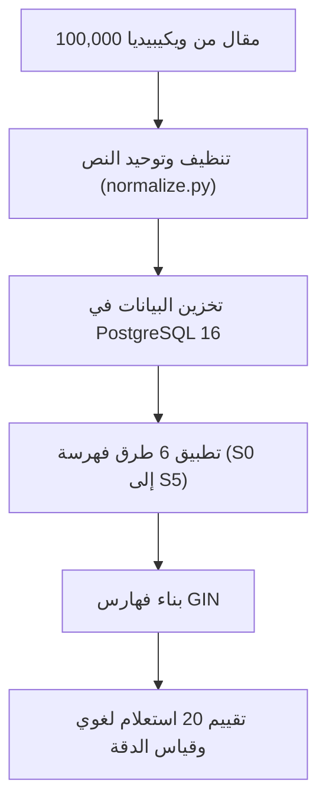

# مشروع الفهرسة النصية للغة العربية في PostgreSQL 16
مشروع تخرج - دراسة ومقارنة طرق البحث النصي (Full-Text Search) بالاعتماد على الجذور وقص الزوائد.

* **إعداد الطالب:** مروان محمد خليف
* **إشراف:** د. ريا محمد محمود

---

## الأدوات المستخدمة في المشروع

* **قاعدة البيانات:** PostgreSQL 16
* **بيئة التشغيل:** Docker و Docker Compose
* **لغة البرمجة:** Python 3.12 (مكتبات psycopg, pytest, pandas)
* **إضافات قاعدة البيانات:** pg_trgm (للمقاطع الثلاثية) و unaccent
* **مجموعة البيانات (Dataset):** 100,000 مقال من ويكيبيديا العربية (حوالي 49 مليون كلمة)

---

## فكرة المشروع والمشكلة

قواعد البيانات العادية ومنها PostgreSQL تفشل بالبحث باللغة العربية لأن العربي لغة اشتقاق، يعني كلمة وحدة مثل (كتب) تطلع منها: (يكتبون، كاتب، كتاب، مكتبة).

إذا بحثت في PostgreSQL عن كلمة "كتب":
```sql
SELECT to_tsvector('simple', 'يكتبون في المكتبة') @@ to_tsquery('simple', 'كتب');
```
النتيجة تطلع FALSE، لأن البحث يطابق الحروف فقط وما يفهم إن الكلمات ترجع لنفس الأصل.

بهذا المشروع قمت بتطبيق ومقارنة 6 طرق مختلفة للبحث حتى نشوف ياهي تنطي أفضل دقة وأسرع وقت وأقل مساحة تخزين.



---

## الطرق الـ 6 المقارنة

| الرمز | الطريقة | الوصف | مثال لكلمة «المكتبات» | حجم الفهرس |
|:---:|:---|:---|:---:|:---:|
| **S0** | البحث العادي | يأخذ الكلمة مثل ما هي بدون أي تعديل | `المكتبات` | 255 MB |
| **S1** | العادي مع حذف كلمات التوقف | يحذف حروف الجر والضمائر (في، من، على) | `المكتبات` | 178 MB |
| **S2** | قص الزوائد (Larkey Light Stemming) | يحذف السوابق واللواحق الشائعة (الـ، والـ، ـات، ـون) | `مكتب` | 143 MB |
| **S3** | استخراج الجذر بالقوالب (ISRI Root) | يستخرج الجذر بالاعتماد على أوزان الكلمات | `كتب` | 97 MB |
| **S4** | استخراج الجذر بالقاموس (Khoja Root) | يستخرج الجذر ويتأكد منه عبر معجم فيه 4,748 جذر | `كتب` | 96 MB |
| **S5** | المقاطع الثلاثية (Trigram) | يقطع الكلمة لثلاثيات أحرف للبحث عن التشابه | `الم`، `لمك`، `مكت` | 207 MB |

---

## تنظيف وتوحيد النصوص (Normalization)

قبل الفهرسة، سويت كود في `normalize.py` حتى يوحد الحروف:
1. حذف التشكيل والتنوين والشدة.
2. حذف المد والتطويل (الكشيدة).
3. توحيد الألف (أ، إ، آ -> ا)، والياء (ى -> ي)، والتاء المربوطة (ة -> ه).
4. تحويل الأرقام الشرقية (١، ٢، ٣) إلى أرقام عادية (1, 2, 3).
* الكود مفحوص بـ 22 فحص آلي عبر pytest بنسبة نجاح 100%.

---

## نتائج التقييم بالأرقام

تم تقييم الأنظمة بـ 20 استعلام لغوي متنوع:

| النظام | دقة أول 10 نتائج (P@10) | الاسترجاع الكلي (Recall) | حجم الفهرس | زمن الاستعلام |
|:---|:---:|:---:|:---:|:---:|
| **S0 (البحث العادي)** | 35% | 44% | 255 MB | 127 ms |
| **S1 (مع حذف كلمات التوقف)** | 26% | 38% | 178 MB | 120 ms |
| **S2 (قص الزوائد Larkey)** | **46%** (الأعلى دقة) | 67% | 143 MB | 218 ms |
| **S3 (جذور ISRI)** | 44% | **70%** | 97 MB | 387 ms |
| **S4 (جذور Khoja)** | 45% | **70%** (الأعلى استرجاع) | **96 MB** (توفير 62%) | 332 ms |
| **S5 (المقاطع Trigram)** | 5% | 11% | 207 MB | 64 ثانية (بطيء) |

---

## مشكلة تداخل الكلمات (Over-stemming)

طريقة الجذور (Khoja) توفر مساحة وتجيب نتائج أكثر، بس مشكلتها ترجع كلمات مختلفة لنفس الجذر وتخربط المعنى:
* **استعلام «بحر»:** خوارزمية الجذور رجعت مقالات عن دولة «البحرين» لأنها اعتبرتها من جذر (بحر)، بينما طريقة قص الزوائد (Larkey) ما وقعت بهذا الخطأ.
* **استعلام «عين»:** خلطت بين عين الماء وعين الإنسان وبلدة «عين العرب».
* **أين تتفوق طريقة الجذور؟** بجموع التكسير؛ مثلاً كلمة «أشجار» ما يعرفها قص الزوائد كجمع لـ «شجرة»، بينما طريقة الجذور ترجع الاثنين لجذر (شجر) وتلقى المقالات.

---

## الخلاصة

1. **للاستخدام العملي والنتائج الدقيقة:** طريقة قص الزوائد **Larkey (S2)** هي الأفضل لأن دقتها بأول صفحة للمستخدم 46%.
2. **لتقليل المساحة:** طريقة **Khoja (S4)** توفر 62% من حجم الفهرس.
3. **التوصية:** استخدام نظام هجين؛ يبحث أولاً بطريقة قص الزوائد، وإذا كانت النتائج قليلة يتحول لطريقة الجذور حتى لا تفوت النتائج المشتقة وجموع التكسير.

---

## طريقة تشغيل المشروع

### المتطلبات:
* Docker
* Python 3.12

### الخطوات:

1. تشغيل قاعدة البيانات:
```bash
docker compose up -d
```

2. تثبيت المكتبات:
```bash
pip install -r requirements.txt
```

3. فحص الاتصال وتشغيل الاختبارات:
```bash
python -m src.db.verify_env
pytest tests/test_normalize.py
```

4. تحميل البيانات وبناء الفهارس:
```bash
python -m src.corpus.ingest_docs
python -m src.indexing.build_indexes
```

5. تشغيل التقييم:
```bash
python -m src.benchmarks.evaluate_ir
python -m src.benchmarks.overstemming_analysis
```

---

## هيكل الملفات

```
.
├── docker-compose.yml              # إعداد حاوية PostgreSQL 16
├── requirements.txt                # مكتبات بايثون المطلوبة
├── initdb/01_init.sql              # تهيئة قاعدة البيانات والإضافات
├── src/
│   ├── preprocessing/normalize.py  # كود تنظيف وتوحيد النصوص
│   ├── indexing/                   # خوارزميات الفهرسة وبناء فهارس GIN
│   │   ├── stemmers/               # خوارزميات Larkey, ISRI, Khoja
│   │   └── build_indexes.py
│   ├── corpus/                     # جلب نصوص ويكيبيديا وتخزينها
│   ├── db/                         # الاتصال بقاعدة البيانات
│   └── benchmarks/                 # كود التقييم وحساب الدقة والسرعة
├── queries/                        # الـ 20 استعلام الذهبي مع التقييمات
├── tests/                          # فحوصات pytest
├── data/khoja_roots.txt            # قاموس الجذور لخوارزمية خوجة
└── tsearch_data/arabic.stop        # قائمة كلمات التوقف
```
