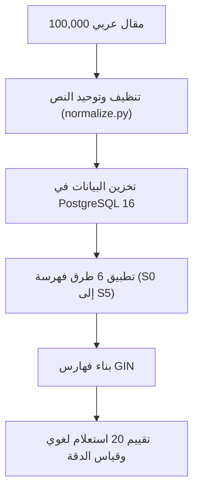

# مشروع الفهرسة النصية للغة العربية في PostgreSQL 16

---

## الأدوات المستخدمة في المشروع

* **قاعدة البيانات:** PostgreSQL 16
* **بيئة التشغيل والحاويات:** Docker و Docker Compose
* **لغة البرمجة:** Python 3.12 (مكتبات psycopg, pytest, pandas, fastapi)
* **إضافات قاعدة البيانات:** pg_trgm (للمقاطع الثلاثية) و unaccent
* **مجموعة البيانات (Dataset):** 100,000 مقال باللغة العربية (حوالي 49 مليون كلمة)

---

## فكرة المشروع والمشكلة

تفشل محركات وقواعد البيانات التقليدية في مطابقة النصوص العربية بدقة، نظراً لأن اللغة العربية لغة اشتقاقية صرفية غنية، حيث تتفرع من الجذر الواحد (مثل: كتب) مشتقات متعددة: (يكتبون، كاتب، كتاب، مكتبة).

إذا بحثت في PostgreSQL عبر التهيئة البسيطة (Simple) عن كلمة "كتب":
```sql
SELECT to_tsvector('simple', 'يكتبون في المكتبة') @@ to_tsquery('simple', 'كتب');
```
تكون النتيجة FALSE، لأن البحث يطابق الرسم السطحي للحروف فقط دون إدراك الرابط الصرفي بين المشتقات.

في هذا المشروع، تم تطبيق ومقارنة 6 طرق مختلفة للفهرسة واسترجاع المعلومات لتقييم الدقة وسرعة الاستعلام ومساحة التخزين.



---

## الطرق الـ 6 المقارنة

| الرمز | الطريقة | الوصف | مثال لكلمة «المكتبات» | حجم الفهرس |
|:---:|:---|:---|:---:|:---:|
| **S0** | البحث السطحي المباشر (Surface Simple) | يأخذ الكلمة كما هي دون أي تعديل صرفي | `المكتبات` | 255 MB |
| **S1** | البحث السطحي مع حذف كلمات التوقف | يستبعد حروف الجر والضمائر والروابط الشائعة | `المكتبات` | 178 MB |
| **S2** | قص الزوائد الصرفية (Light Stemming) | يحذف السوابق واللواحق الشائعة (الـ، والـ، ـات، ـون) مع الحفاظ على بنية الكلمة | `مكتب` | 143 MB |
| **S3** | استخراج الجذر الصرفي بالقوالب والأوزان | يستخرج الجذر الثلاثي عبر موازنة الكلمة بأوزان وقوالب الصرف العربي | `كتب` | 97 MB |
| **S4** | استخراج الجذر المعجمي (Dictionary Root) | يستخرج الجذر ويتحقق من صحته بمطابقته مع معجم الجذور المعتمد | `كتب` | 96 MB |
| **S5** | المقاطع الثلاثية للأحرف (Trigram) | يجزئ الكلمات إلى ثلاثيات حروف متداخلة لحساب نسبة التشابه الإملائي | `الم`، `لمك`، `مكت` | 207 MB |

---

## تنظيف وتوحيد النصوص (Normalization)

قبل إجراء الفهرسة، تُعالج النصوص عبر مسار التوحيد (`normalize.py`):
1. إزالة التشكيل، التنوين، وحركات الإعراب.
2. حذف المد والتطويل (الكشيدة).
3. توحيد صور الألف (أ، إ، آ -> ا)، والياء (ى -> ي)، والتاء المربوطة (ة -> ه).
4. تحويل الأرقام المشرقية إلى الأرقام القياسية (1, 2, 3).
* جميع عمليات التوحيد مدعومة باختبارات آلية تغطي كافة الحالات بنسبة نجاح 100%.

---

## نتائج التقييم

تم قياس أداء الأنظمة عبر 20 استعلاماً لغوياً نموذجياً يغطي مختلف الأنماط الصرفية:

| النظام | دقة أول 10 نتائج (P@10) | الاسترجاع الكلي (Recall) | حجم الفهرس | متوسط زمن الاستعلام |
|:---|:---:|:---:|:---:|:---:|
| **S0 (البحث السطحي)** | 35% | 44% | 255 MB | 127 ms |
| **S1 (مع حذف كلمات التوقف)** | 26% | 38% | 178 MB | 120 ms |
| **S2 (قص الزوائد الصرفية)** | **46%** (الأعلى دقة) | 67% | 143 MB | 218 ms |
| **S3 (الجذر الصرفي بالأوزان)** | 44% | **70%** | 97 MB | 387 ms |
| **S4 (الجذر المعجمي بالقاموس)** | 45% | **70%** (الأعلى استرجاعاً) | **96 MB** (توفير 62%) | 332 ms |
| **S5 (المقاطع الثلاثية Trigram)** | 5% | 11% | 207 MB | 64 ثانية |

---

## تحليل التداخل الدلالي (Over-stemming)

تتميز طرق التجذير الكامل (S3 وS4) بتقليص مساحة التخزين وزيادة معدل الاسترجاع، لكنها قد تواجه ظاهرة التداخل الدلالي عند رد كلمات مختلفة المعنى إلى نفس الجذر المشترك:
* **استعلام «بحر»:** استرجعت أنظمة الجذور وثائق تخص «البحرين» نظراً للاشتراك في الجذر (بحر)، بينما اقتصر نظام قص الزوائد (S2) على السياقات البحرية المباشرة.
* **استعلام «عين»:** جمعت أنظمة الجذور بين عين الماء وعين الإنسان والأسماء الجغرافية المشتقة.
* **ميزة أنظمة الجذور:** التفوق في معالجة جموع التكسير المعقدة والمصادر القياسية؛ فكلمة «أشجار» لا يربطها نظام قص الزوائد بمفردها «شجرة»، في حين يجمعهما نظام الجذور تحت الجذر (شجر) بنجاح.

---

## الاستنتاجات والتوصيات

1. **للتطبيقات العملية وتصدر النتائج الدقيقة:** نظام قص الزوائد **(S2 - Light Stemming)** يقدم أفضل توازن عملي بدقة تصل إلى 46% في النتائج العشر الأولى.
2. **لترشيد استهلاك مساحات التخزين:** نظام الجذر المعجمي **(S4 - Dictionary Root)** يحقق أقصى كفاءة تخزينية باختزال 62% من حجم الفهرس مع نسبة استرجاع بلغت 70%.
3. **التوصية الهندسية:** اعتماد معمارية بحث هجينة (Hybrid Search)، تبدأ بالبحث السطحي وقص الزوائد، ثم تتوسع تدريجياً للاشتقاق الجذري عند انخفاض عدد النتائج المسترجعة.

---

## طريقة تشغيل المشروع بالكامل (الموقع وقاعدة البيانات)

يتم تشغيل المشروع كاملاً (حاوية قاعدة البيانات PostgreSQL 16 + حاوية واجهة الويب التفاعلية) بأمر واحد فقط عبر Docker Compose:

```bash
docker compose up -d --build
```

عند اكتمال التشغيل، يصبح النظام متاحاً بالكامل:
* **واجهة البحث والموقع:** تفتح مباشرة عبر المتصفح على الرابط: **`http://localhost:8000`** (أو عبر النطاق المحلي: `http://arabic-ir-web.arabic-ir.orb.local`).
* **قاعدة البيانات:** تعمل في الخلفية على المنفذ `5432` ومرتبطة تلقائياً بمحرك البحث.

### إدارة تشغيل الحاويات:
* **متابعة سجلات النظام (Logs):**
  ```bash
  docker compose logs -f
  ```
* **إيقاف النظام بالكامل:**
  ```bash
  docker compose down
  ```

---

## تشغيل الاختبارات البرمجية (اختياري للمطورين)

لتشغيل حزم الاختبارات الآلية (179 اختباراً) محلياً:

```bash
pip install -r requirements.txt
pytest tests/
```

---

## هيكل الملفات

```
.
├── Dockerfile                      # حاوية تطبيق واجهة الويب
├── docker-compose.yml              # تشغيل قاعدة البيانات والواجهة
├── requirements.txt                # متطلبات بيئة بايثون
├── initdb/01_init.sql              # تهيئة قاعدة البيانات والإضافات
├── src/
│   ├── web/                        # خادم FastAPI ومحرك البحث للواجهة
│   │   ├── app.py                  # مسارات الـ API
│   │   ├── search_service.py       # منطق استرجاع البيانات والمقارنة
│   │   ├── static/css/style.css    # التنسيقات والواجهة الانسيابية
│   │   ├── static/js/app.js        # التفاعل مع الواجهة
│   │   └── templates/index.html    # صفحة البحث الرئيسية
│   ├── preprocessing/normalize.py  # تنظيف وتوحيد النصوص العربية
│   ├── indexing/                   # خوارزميات الفهرسة وبناء فهارس GIN
│   │   ├── stemmers/               # وحدات التجذير وقص الزوائد الصرفية
│   │   └── build_indexes.py
│   ├── corpus/                     # استيراد ومعالجة نصوص المقالات
│   ├── db/                         # إدارة الاتصال بقاعدة البيانات
│   └── benchmarks/                 # حساب مقاييس الدقة والاسترجاع
├── queries/                        # الاستعلامات الـ 20 النموذجية
├── tests/                          # حزم الاختبارات التلقائية
├── data/                           # معجم الجذور الثلاثية والرباعية المعتمد
└── tsearch_data/arabic.stop        # قائمة كلمات التوقف العربية
```
